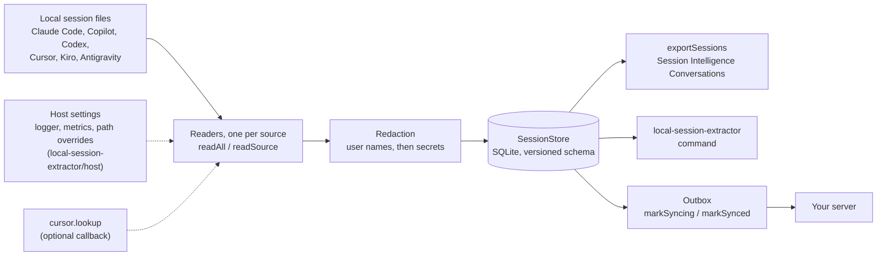
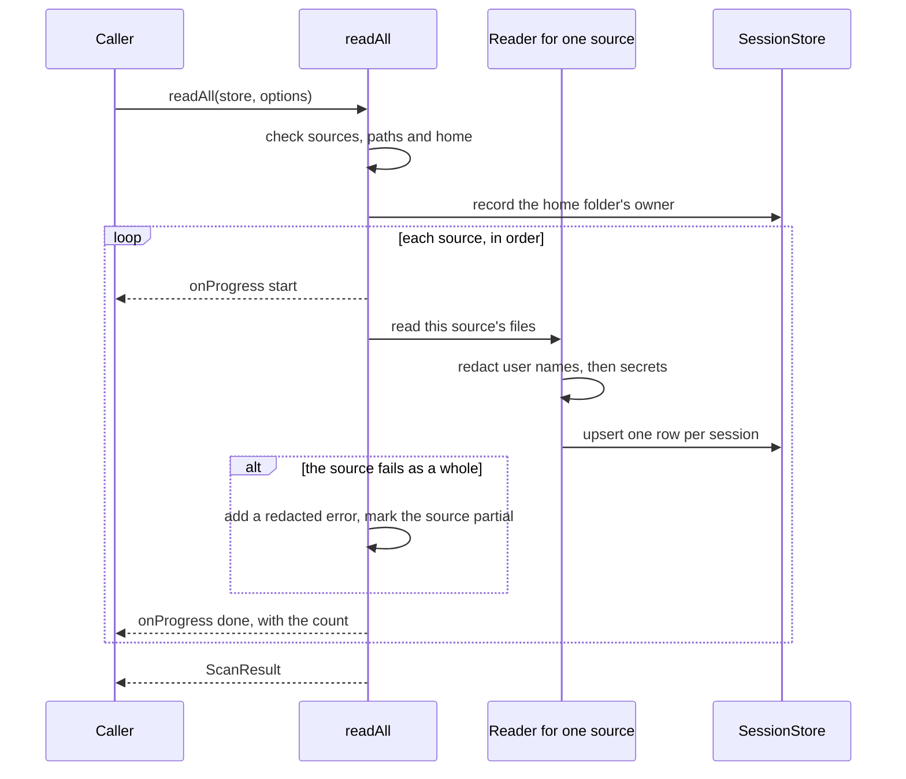

# How a scan runs

How the package fits together, and one scan followed from start to result. The [README](https://github.com/tetriz-ai/agent-desk/blob/main/packages/local-session-extractor/README.md) shows how to install and use it.

## How the parts fit

The package turns each session file an AI coding tool leaves on a Mac into one normalized row. It masks secrets, email addresses in session text and your user name, then stores the row in a local SQLite file. Each tool's login email and account ids are kept as they are, as [Redaction](limits.md#redaction) says.

Use it as the `local-session-extractor` command or as a library through `openStore`, `readAll` and `exportSessions`. The outbox and the host settings are for embedding it in your own app, and [docs/reference.md](https://github.com/tetriz-ai/agent-desk/blob/main/packages/local-session-extractor/docs/reference.md) covers both. [Agent Desk](https://github.com/tetriz-ai/agent-desk/blob/main/README.md), the menu bar app in the same repository, reads its sessions through this package.

## One scan, step by step

A scan first checks its options and throws before reading anything when one is wrong. It then records the owner of the home folder it reads, so a later export hashes that name too.

Each source runs in turn, and a source that fails is marked partial while the next one still runs. The result carries the counts, the errors, the partial sources and any record kinds the readers did not know.
